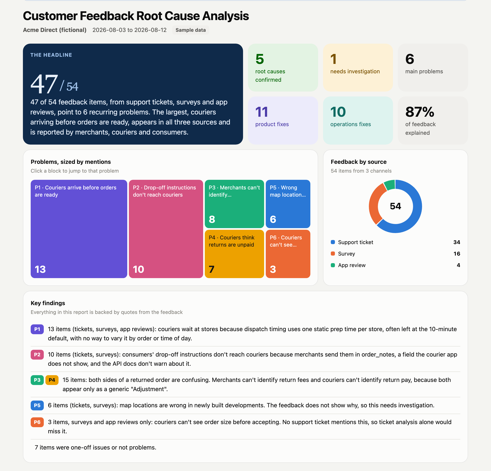
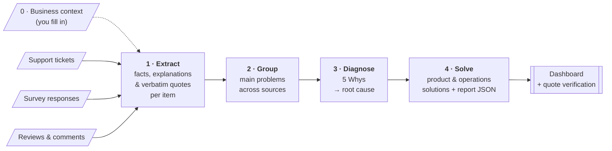
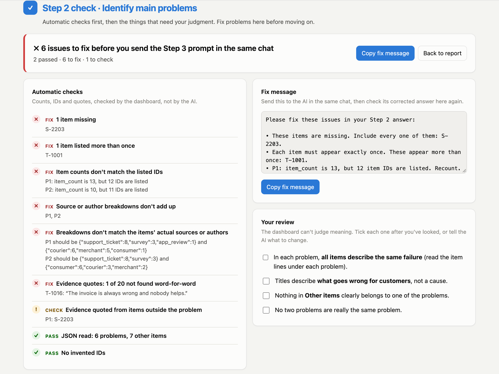
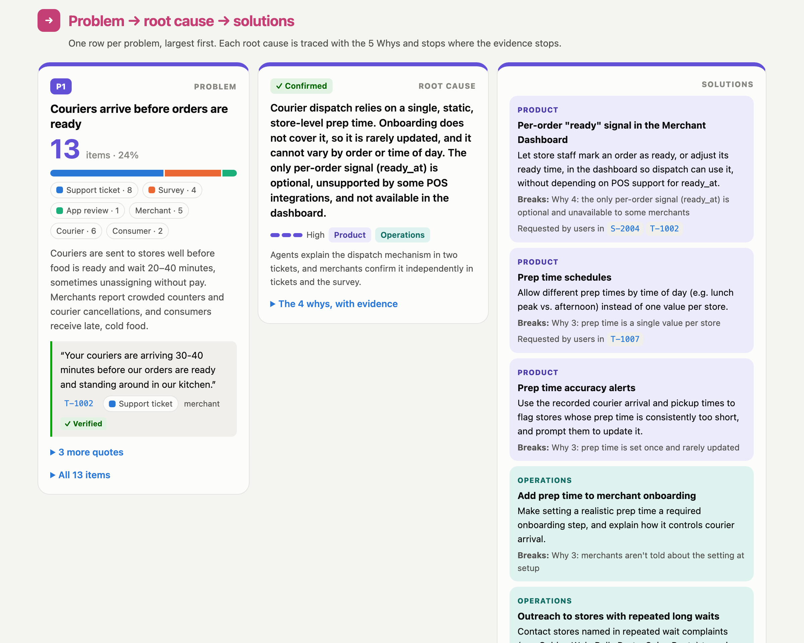
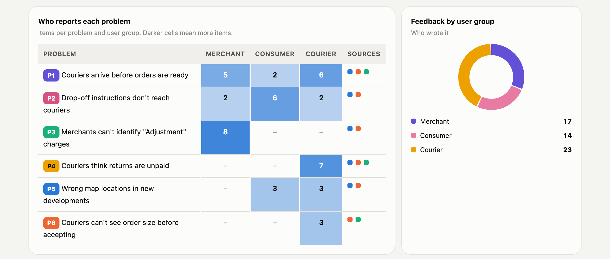
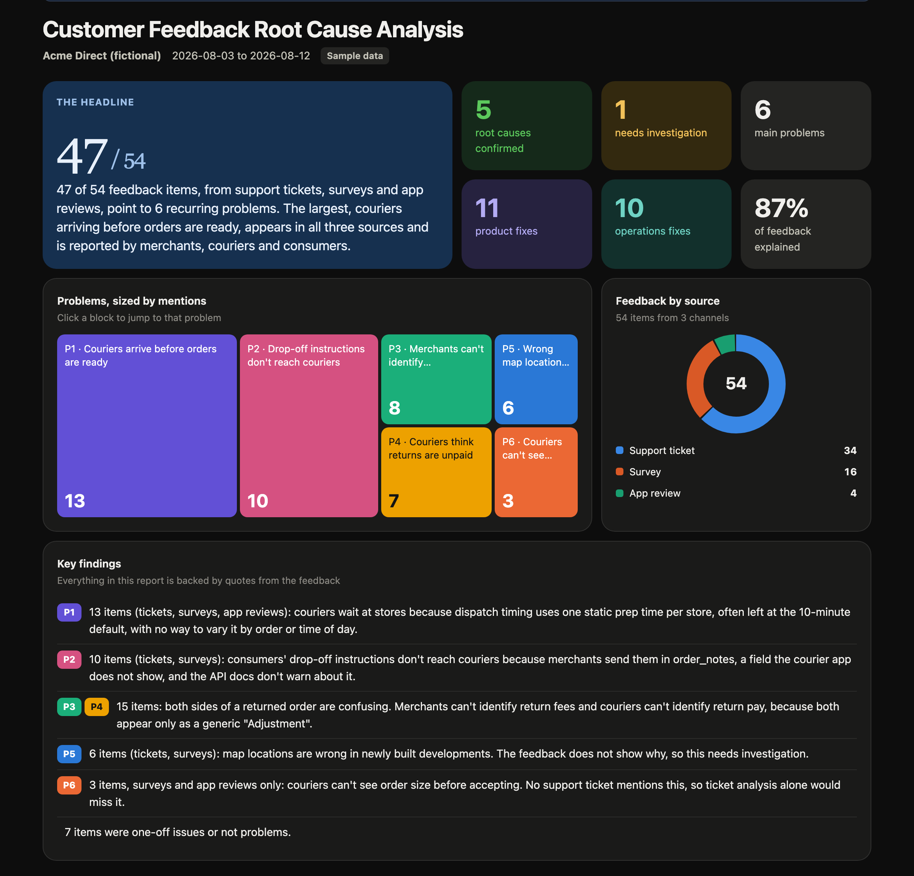

# Customer Feedback Root Cause Analysis — an AI Workflow

**Turn raw customer feedback (support tickets, survey responses, app reviews and comments) into an evidence-backed report of the main problems, their root causes, and product and operations fixes.**

A four-step prompt workflow that works in any AI chat tool (ChatGPT, Claude, Gemini, or an internal tool), plus a dashboard that presents the results and checks every quote against the original feedback.

**[▶ Live demo dashboard](https://ying-jiao.github.io/voice-of-customer/dashboard/)** · [How to run it](#how-to-run-it) · [Sample report](examples/sample_report.json) · [Sample feedback](examples/sample_feedback.csv)



---

## Why this exists

Customer feedback is scattered across support tickets, surveys, app reviews and comments, and the patterns behind it rarely reach the product and operations teams who could fix them. Reading it all by hand doesn't scale. Asking an AI to "summarize the feedback" usually returns plausible-sounding themes, invented causes and no way to check either.

This workflow was originally built and used on real support tickets at a last-mile delivery platform. It is designed so the output is **trustworthy enough to act on**:

- **Grounded:** every claim is traced to a verbatim quote from a specific feedback item.
- **Multi-source:** tickets, surveys, reviews and comments are analyzed together, and the report shows which sources and user groups each problem appears in.
- **Root causes, not symptoms:** the 5 Whys framework is applied with an explicit test for what counts as a root cause.
- **Actionable:** every root cause leads to product and operations solutions, and each solution names the link in the why-chain it breaks.
- **Honest about gaps:** when the feedback doesn't explain *why*, the analysis stops and marks the cause as *needs investigation* instead of guessing.

> This public version uses a fictional company (**Acme Direct**, an on-demand delivery platform) and 54 synthetic feedback items: 34 support tickets, 16 survey responses and 4 app reviews. It contains no real customer data.

## How it works



| Step | File | Output |
|---|---|---|
| 0 | [Business context template](context/business_context_template.md) | Your product, users, flows, terms and feedback sources, with an example for every field |
| 1 | [Extract feedback facts](prompts/01_extract_feedback_facts.md) | One structured record per item: issue, stated explanations, requests, verbatim quotes |
| 2 | [Identify main problems](prompts/02_identify_main_problems.md) | Recurring problems ranked by mentions, broken down by source and user group |
| 3 | [Root cause (5 Whys)](prompts/03_root_cause_5_whys.md) | An evidence-backed why-chain, root cause and confidence level per problem |
| 4 | [Solutions & report](prompts/04_solutions_and_report.md) | Product and operations solutions, plus the final report JSON |
| — | [Dashboard](dashboard/index.html) | Summary → Main problems → Root causes → Potential solutions |

### Why four steps instead of one big prompt?
- **Scale:** Step 1 can run in batches, so you aren't limited by how much feedback fits in one message.
- **Accuracy:** each step does one job, and each step's output is the next step's only input. That makes it harder for unsupported claims to slip in.
- **Checkpoints:** every step is checked before the next one starts, so a mistake is fixed where it happens instead of carrying through to the final report.

## How to run it

**Who does what:**
- **You** send four prompts to an AI chat tool and check each answer.
- **The AI** does the analysis.
- **The dashboard** checks the AI's work and shows the final report.

The AI doesn't build the dashboard: its final answer is data (JSON), which you load into `dashboard/index.html`. That keeps every report consistent and lets the dashboard check the AI's numbers and quotes against your original feedback.

**You need:**
- **This repository on your computer:** click the green **Code** button on GitHub → **Download ZIP**, then unzip it.
- **An AI chat tool that accepts file attachments,** such as ChatGPT, Claude or Gemini.
- **A web browser.**

> **Just want to try it?** Use the sample files instead of your own: [`examples/business_context_acme_direct.md`](examples/business_context_acme_direct.md) and [`examples/sample_feedback.csv`](examples/sample_feedback.csv). Compare your result with the [live demo](https://ying-jiao.github.io/voice-of-customer/dashboard/).

### 1. Prepare your two input files
- **Feedback CSV:** combine your tickets, survey responses, reviews and comments into one CSV, using the [input format](#supported-input). Remove personal data (names, emails, phone numbers, addresses) and anything your company doesn't allow in your AI tool.
- **Business context (Step 0):** copy [`context/business_context_template.md`](context/business_context_template.md) and fill it in. Every section has an example, and [here is a complete one](examples/business_context_acme_direct.md).

**Don't edit the prompt files.** They are used exactly as they are.

### 2. Open the dashboard
Double-click `dashboard/index.html` to open it in your browser. Click **Verify quotes** and choose your feedback CSV, which the dashboard uses for every check. Keep this tab open.

### 3. Run the four steps in one chat
Start a **new chat** and run all four steps in it, in order. For each step:
1. Attach the files listed below.
2. Send the short message.
3. Wait for the complete answer.
4. Check the answer (section 4) **before** sending the next step.

**Step 1.** Attach `prompts/01_extract_feedback_facts.md`, your business context and your feedback CSV. Replace the two file names below with yours.
```text
Follow the prompt in the attached 01_extract_feedback_facts.md. Use only the part below the "---" line; the text above it is notes for me. The business context is business_context_acme_direct.md and the feedback is sample_feedback.csv.
```

**Step 2.** Attach `prompts/02_identify_main_problems.md`.
```text
Follow the prompt in the attached 02_identify_main_problems.md. Use only the part below the "---" line. Use your Step 1 answer above as the input.
```

**Step 3.** Attach `prompts/03_root_cause_5_whys.md`.
```text
Follow the prompt in the attached 03_root_cause_5_whys.md. Use only the part below the "---" line. Use your Step 1 and Step 2 answers above as the input.
```

**Step 4.** Attach `prompts/04_solutions_and_report.md`.
```text
Follow the prompt in the attached 04_solutions_and_report.md. Use only the part below the "---" line. Use your Step 2 and Step 3 answers above as the input.
```

**What each answer looks like:** Steps 1–3 start with a short review table, followed by a JSON code block. Step 4 is **JSON only**, which is expected: the dashboard turns it into the report.

> **Tool doesn't support attachments?** Open each prompt file, copy everything below the `---` line, and paste it as your message, unchanged. Paste your business context and feedback into Step 1 where it says `{{BUSINESS_CONTEXT}}` and `{{FEEDBACK}}`.

### 4. Check each answer before moving on
1. Copy the AI's **whole answer**, both the review table and the JSON.
2. In the dashboard, click **✓ Check a step**, paste it and click **Check**. The dashboard works out which step it is.
3. **If anything is marked ✗:** click **Copy fix message**, send it to the AI in the same chat, then check the corrected answer again.
4. **When nothing is marked ✗:** go through the **Your review** checklist (the questions only a person can judge), then send the next step.

### 5. View the report
After Step 4 passes its check, click **View the report →**. Use **Print / PDF** to share it. To reopen it later, save the Step 4 JSON as a `.json` file and use **Load report**.

### If something goes wrong

| What you see | What to do |
|---|---|
| The answer stops partway through | Send *"Continue exactly where you stopped."* Then copy all parts of the answer together into the checker. |
| The answer has no review table or no JSON code block | Send *"Please follow the Output section of the attached prompt exactly."* |
| The dashboard says it couldn't read the answer | Make sure you copied the whole answer, including the JSON code block. If it was cut off, ask the AI to *"resend the complete JSON in one code block."* |
| Checks say "not checked yet" | Load your feedback CSV with **Verify quotes**. |
| Step 1 is slow or misses items with a lot of feedback | Split your CSV into files of about 40 items. Run Step 1 once per file in the same chat, then ask the AI to combine the JSON arrays into one before Step 2. |

## Checked at every step

Each AI answer starts with a short **review table** for a person to read, followed by the JSON. Before moving on, you paste the whole answer into the dashboard's **✓ Check a step**. The work is split by what each side is good at:

| | Checked by the dashboard (automatic) | Checked by you (judgment) |
|---|---|---|
| **1 · Extract** | Every item present, no invented IDs, quotes word-for-word | Items marked "not a problem" really aren't problems |
| **2 · Problems** | Counts match the listed IDs, every item appears exactly once, breakdowns match the real sources, quotes verified | Items in each problem describe the same failure; titles describe problems, not causes |
| **3 · Root causes** | Every problem has a chain, every link has evidence, chains that stop early are marked *needs investigation*, high confidence includes an agent explanation | Each root cause is a real cause, within the company's control and actionable |
| **4 · Report** | All of the above, plus totals and summary numbers match the problems | Solutions fix the root cause, not the symptom |

Countable things are checked mechanically, because an AI checking its own counts is not reliable. When something fails, the dashboard writes a **fix message** you send back to the AI in the same chat. Then you check the corrected answer again.



## Supported input

Any mix of feedback in one CSV file, one row per item ([template](context/feedback_template.csv)):

| Column | Required | Description |
|---|---|---|
| `item_id` | ✓ | Unique ID, e.g. `T-1001` for tickets, `S-2001` for surveys, `R-3001` for reviews |
| `source` | ✓ | Where it came from: `support_ticket`, `survey`, `app_review`, `comment`, or your own label |
| `author_type` | ✓ | Who wrote it, e.g. `merchant`, `consumer`, `courier` |
| `text` | ✓ | The feedback. For tickets, the whole conversation with each message prefixed by `[Speaker]` |
| `created_at` | | Date |
| `title` | | Ticket subject, survey question or review rating |

Different sources can prove different things, and the prompts treat them accordingly. A support agent explaining how the system works is strong evidence of a **cause**. A survey answer or review proves what the author **experienced**, but their explanation of why is treated as a claim. A problem that appears independently in several sources is weighted as stronger evidence.

## Guardrails

These rules are repeated in every prompt:

1. **Feedback is the only evidence.** The business context helps the model understand terms and how the product works. It is never treated as proof that something happened.
2. **No inference, assumption or invention.** Missing information is written as `null` or "Not evidenced in the feedback".
3. **Quotes are verbatim** and attributed to an item ID and speaker. The dashboard checks this mechanically (see below).
4. **Counts are exact.** Problems are ranked by real item counts, and the final step recounts every number in the summary.

### What counts as a root cause
The 5 Whys stops when a cause passes all three tests:

| Test | Fails | Passes |
|---|---|---|
| **Not the symptom** | "Couriers arrive too early" | "Dispatch uses one static prep time per store" |
| **Within the company's control** | "Merchants entered the wrong prep time" | "Onboarding never asks merchants to set prep time, so it stays at the default" |
| **Actionable** | "Restaurants are busy" | Points to a clear change, e.g. a per-order "ready" signal or an onboarding step |

If the evidence runs out first, the chain stops. The cause is marked **needs investigation**, and the solutions become investigation steps. P5 in the sample report shows this.



## The dashboard

A single HTML file with no dependencies and no server. Your data stays in your browser. It's laid out as an executive one-pager first, with the details underneath:

- **Overview:** the headline number, status tiles (causes confirmed, causes needing investigation, product and operations fixes, share of feedback explained), a **treemap** of problems sized by mentions (click a block to jump to it), a **donut chart** of feedback sources, and the key findings
- **Who and where:** a **heatmap** of which user groups report each problem, with its sources, and a donut chart of user groups
- **Problem → root cause → solutions:** one row per problem, with three tiles side by side:
  - **Problem:** item count, source mix and evidence quotes
  - **Root cause:** status, confidence and the 5-Whys chain with its evidence
  - **Solutions:** product and operations fixes, each naming the link in the chain it breaks and which users asked for it
- **✓ Check a step:** paste the AI's answer from any step for automatic checks, a ready-to-send fix message, a review checklist and a readable view (see [Checked at every step](#checked-at-every-step))
- **Quote verification:** load your feedback CSV with **Verify quotes**. Every quote in the report is checked against its item, marked ✓ or ✗, and linked to the original text with the quote highlighted. An AI can't fake a quote without it showing up in red.
- **Light and dark mode** (add `?theme=dark` to the URL to share a dark view), and **Print / PDF**





## Sample findings (Acme Direct)

| # | Main problem | Items | Sources | Root cause | Status |
|---|---|---|---|---|---|
| P1 | Couriers arrive before orders are ready | 13 | Tickets, surveys, reviews | Dispatch relies on a single static prep time per store, rarely updated and unable to vary by order or hour | Confirmed |
| P2 | Drop-off instructions don't reach couriers | 10 | Tickets, surveys | API has two similar note fields, but the courier app shows only one, and nothing warns integrators | Confirmed |
| P3 | Merchants can't identify "Adjustment" charges | 8 | Tickets, surveys | Return fees use a generic invoice label with no order ID and are documented only in the merchant terms | Confirmed |
| P4 | Couriers think returns are unpaid | 7 | Tickets, surveys, reviews | Return pay arrives later as an unlinked "Adjustment" with no pending state | Confirmed |
| P5 | Wrong map locations in new developments | 6 | Tickets, surveys | Not evidenced in the feedback | Needs investigation |
| P6 | Couriers can't see order size before accepting | 3 | Surveys, reviews | Offer screen doesn't show order size before acceptance | Confirmed (medium) |

P6 never appears in a support ticket. Analyzing tickets alone would have missed it.

## Repository structure

```
voice-of-customer/
├── prompts/                         # The workflow: four prompts, run in order
├── context/
│   ├── business_context_template.md # Step 0, with an example for every field
│   └── feedback_template.csv        # Input format
├── dashboard/
│   └── index.html                   # Self-contained report viewer + quote verification
├── examples/
│   ├── sample_feedback.csv          # 54 synthetic items: tickets, surveys, app reviews
│   ├── business_context_acme_direct.md
│   └── sample_report.json           # Output of Steps 1–4 on the sample feedback
└── docs/                            # Screenshots
```

## Limitations

- **Human review is required.** The workflow reduces hallucination risk but does not eliminate it. Treat the report as a well-sourced draft.
- **Feedback shows what customers report, not everything that happens.** Problems that customers don't write about won't appear, and item counts are not incident rates.
- **Quote verification checks quotes, not reasoning.** A real quote can still support a weak conclusion. Read the why-chains.
- **Large volumes:** chat tools work well up to a few hundred items with batching. Beyond that, the same prompts can be run through an API.

## License

[MIT](LICENSE)
